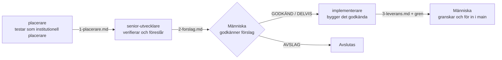

# Agentflöde: Förbättring

**Syfte:** hitta fel och brister ur en institutionell placerares perspektiv och bygga det som en människa godkänner.
**Starta:** `/forbattring [fokus]`

Här sparas varje omgång av flödet, så att det i efterhand går att se vem som föreslog, godkände och byggde vad.

| Fil | Skrivs av | Innehåll |
|---|---|---|
| `<datum>-1-placerare.md` | Agenten **placerare** | Vad som testades, kontrollresultat, fel och behov ur en institutionell placerares perspektiv |
| `<datum>-2-forslag.md` | Agenten **senior-utvecklare** | Prioriterade förslag med teknisk lösning och acceptanskriterier, plus ett beslutsavsnitt |
| *(beslut)* | **Människa** | Godkänner förslag genom att kryssa i `[x] Godkänn` och fylla i *Beslut* (status, namn, datum) |
| `<datum>-3-leverans.md` | Agenten **implementerare** | Vad som byggdes, hur det verifierats, gren och commits |

Implementeraren börjar bara om förslagsfilen har `Status: GODKÄND` (eller `DELVIS GODKÄND`) och en ifylld `Godkänd av`.

