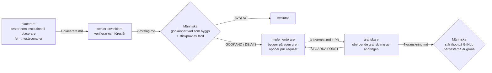

# Agentflöde: Förbättring

**Syfte:** hitta fel och brister ur en institutionell placerares perspektiv och bygga det som en människa godkänner.
**Starta:** `/forbattring [fokus]`

Här sparas varje omgång av flödet, så att det i efterhand går att se vem som föreslog, godkände, byggde, granskade och förde in vad.

| Fil | Skrivs av | Innehåll |
|---|---|---|
| `<datum>-1-placerare.md` | Agenten **placerare** | Vad som testades, kontrollresultat, fel och behov. Varje fel blir också ett scenario i `tests/scenarios/` |
| `<datum>-2-forslag.md` | Agenten **senior-utvecklare** | Prioriterade förslag med lösning, acceptanskriterier och stickprov, plus beslutsavsnitt |
| *(beslut 1)* | **Människa** | Godkänner förslag (`[x] Godkänn`, status, namn, datum). Commit:as på `main` innan bygget |
| `<datum>-3-leverans.md` | Agenten **implementerare** | Vad som byggdes, hur det verifierats, gren, commits och pull request |
| `<datum>-4-granskning.md` | Agenten **granskare** | Oberoende granskning av ändringen: utfall, blockerande och ej blockerande fynd |
| *(beslut 2)* | **Människa** | Slår ihop pull requesten på GitHub |

## Kontroller som inte bygger på att agenterna lyder
| Kontroll | Var | Vad den stoppar |
|---|---|---|
| Agentvakt | `.claude/hooks/agentvakt.mjs` (körs före varje verktygsanrop) | Push till `main`, sammanslagning eller godkännande av pull requests, ändrat grenskydd, ändringar i den riktiga datan, agenter som fyller i eller ändrar beslutet, agenter som ändrar spärrarna |
| Beslutskontroll | GitHub, jobbet `beslut` | Pull request från `forbattring/<datum>` utan mänskligt beslut på `main`, med commits för förslag som inte är godkända eller med ändrat beslut |
| Tester | GitHub, jobbet `test` | Fel i beräkningar, scenarier, typer och bygge |
| Grenskydd | GitHub, inställning för `main` | Ändringar i `main` utan pull request och gröna kontroller |
