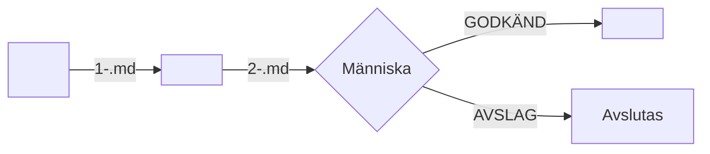

# Mall för ett nytt agentflöde

Ett flöde består av tre delar:

1. **Kommando:** `.claude/commands/<workflow>.md`. Det kör stegen i ordning och stannar vid mänskliga beslut.
2. **Agenter:** `.claude/agents/<agent>.md`. Återanvänd befintliga agenter där det går. Nya agenter börjar med raden om att läsa `docs/agents/RULES.md`.
3. **Mapp:** `docs/agents/workflows/<workflow>.md`, med syfte, diagram och filtabell. Varje omgångs filer hamnar här.

Lägg också till flödet i tabellen i `docs/agents/README.md`.

## README för flödet

~~~markdown
# Agentflöde: <Namn>

**Syfte:** <en mening>
**Starta:** `/<workflow> [argument]`



| Fil | Skrivs av | Innehåll |
|---|---|---|
| `<datum>-1-<namn>.md` | <agent> | <…> |
~~~

## Kommando för flödet

```markdown
---
description: Agentflödet <Namn> – <kort beskrivning av kedjan>.
argument-hint: [<vad användaren kan ange>]
---

Kör agentflödet **<Namn>** i den här ordningen. Följ `docs/agents/RULES.md`.

1. **<Agent>.** Starta agenten `<agent>` med "$ARGUMENTS". Vänta tills `docs/agents/runs/<workflow>/<datum>/1-<artefakt>.md` finns.
2. …
N. **Människans beslut.** Presentera underlaget och fråga användaren. Fyll i beslutet först efter ett uttryckligt svar.
N+1. **Avslut.** Sammanfatta och commit:a flödets filer.
```

## Om flödet ändrar kod
Använd samma slut som flödet `improve`, så att flödet omfattas av spärrarna:
- Grenen heter `<workflow>/<datum>` och förslagsfilen `docs/agents/runs/<workflow>/<datum>/<n>-proposal.md` med beslutsavsnitt och `- [ ] Godkänn` per punkt. Då kontrollerar GitHub beslutet automatiskt.
- Den byggande agenten öppnar en pull request. Därefter granskar `reviewer` ändringen, och en människa slår ihop den.
- Ge varje ny agent ett `maxTurns` i frontmatter som kostnadstak.

## Bra att tänka på
- Lägg det mänskliga beslutet **före** varje steg som ändrar kod eller data, eller kommunicerar externt.
- Låt agenter som bedömer (granskar, testar) vara skilda från agenter som utför (bygger). Det ger oberoende kontroll.
- Ett steg = en fil. Nästa agent ska klara sig med bara den filen.
